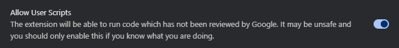
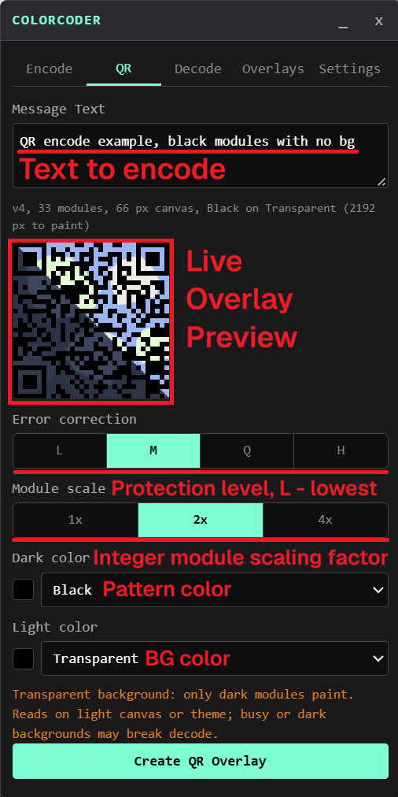
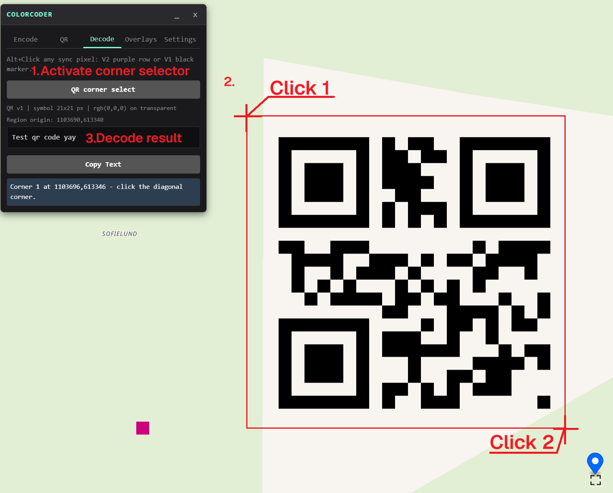
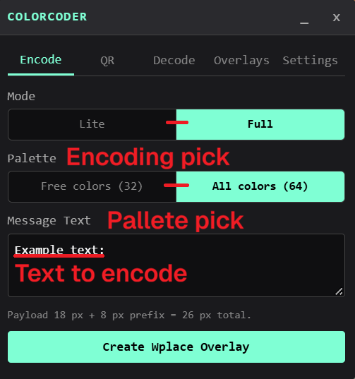
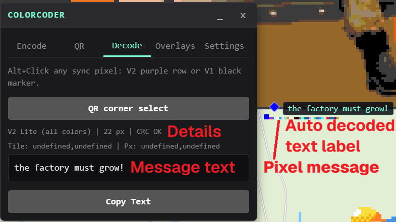
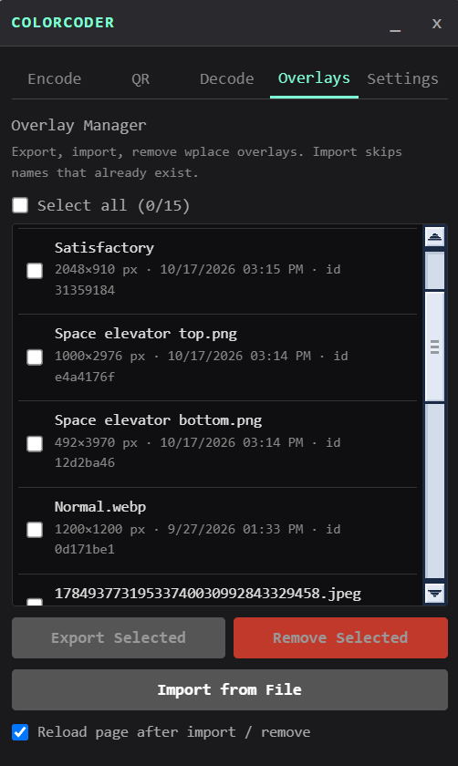

# ColorCoder

Encode, hide, and read secret messages in the pixel canvas of [wplace.live](https://wplace.live).  
Unofficial tool — not affiliated with wplace.

## Install on Chrome

These instructions apply to Chrome and most Chromium-based desktop browsers, including Edge, Brave, and Opera.

1. **Install Tampermonkey.**

   Install [Tampermonkey from the Chrome Web Store](https://chromewebstore.google.com/detail/tampermonkey/dhdgffkkebhmkfjojejmpbldmpobfkfo).

2. **Enable browser support for userscripts.**

   Open your browser's extensions settings and enable **Developer mode**. Then open
   Tampermonkey's details page and enable **Allow User Scripts**. Tampermonkey also
   maintains [browser-specific instructions](https://www.tampermonkey.net/faq.php?locale=en&q=Q209#Q209) for everything else.

   
3. **Click [link](https://github.com/Larik01/ColorCoder/raw/refs/heads/main/dist/script.user.js) to install ColorCoder with Tampermonkey (or build your own, see Build & test below).**

Without this toggle the browser silently refuses every userscript, which is the single most common "the script does nothing" report for any project like this one.

## Script usage

- **QR encode**: the QR pane with EC dial (L/M/Q/H), integer scale (1x/2x/4x), custom color pair, live preview, luminance and locked-color warnings, and transparent background option for saving pixels.

  

- **QR decode**: corner-select — two diagonal clicks on the live canvas, result text in the decode pane.

  

- **Encode**: type your text, pick Lite or Full (Lite saves 25% pixels but has limited alphabet) and Free (32) or All (64) colors → overlay appears in wplace's native overlay list → place it with the native GUI, then paint.

  

- **Autoscan**: intercepts every tile PNG the map fetches, scans for V2 sync rows (including cross-tile seams), decodes messages, registers them under unique magic marker colors, and paints 2x2 markers above each sync. A servo tracks those markers across pan, drag, and zoom with windowed framebuffer reads and dead reckoning during coast.

  

- **Collapsible labels**: each autoscan label is a diamond pin plus a bubble with message text; clicking a label opens the full decode view in the GUI.

- **Manual decode**: Alt+Click any sync pixel to decode that message (V2 windowed first, V1 fallback). If the sync row is damaged or painted over, clicking the first header pixel may still decode: the header alone carries mode, length, and CRC.

- **Palette availability**: the fetch wrapper passively clones wplace's own `/me` response and reads `extraColorsBitmap`. Accounts missing premium colors see "N/32 premium colors are not unlocked, free mode recommended" under the palette toggle, and any encode whose pixel sequence uses colors the account lacks is stopped before injection with a named, color-swatched list and a "Create anyway" escape.

- **Overlay manager** (Overlays tab): list every native overlay with size and timestamp, newest first; export selected ones to a single JSON file including base64 PNG blobs; import from such a file, skipping names that already exist; remove selected ones permanently. Master select-all checkbox with indeterminate state.

  

- **Auto-arm option**: enable in Settings to arm labels automatically when the first message is discovered.

- Supports 4 encoding modes in V2: Lite/Full text, using either All (64) or Free (32) colors. V1 remains fully decodable and encodable via Alt+M as a legacy path.
## Script hotkeys

    Alt+C           Toggle the ColorCoder GUI (encode, decode, overlays, settings)
    Alt+Click       Decode the message starting at the clicked pixel (V2 or V1 fallback;
                    works even when the sync row is damaged or overpainted, via header fallback)
    Alt+L           Arm autoscan labels (scan framebuffer, track markers)
    Alt+Shift+L     Clear labels and disarm
    Alt+M           Legacy: prompt for mode + text -> inject an *unplaced* V1 template -> reload;
                    the only remaining V1 encode path, since the GUI encodes V2 only;
                    then place it with the native overlay GUI

## QR encode & decode

QR codes live alongside strip messages as a second, independent encoding family. The GUI uses warnings rather than blocks: custom color pairs are freely selectable, with luminance and locked-color caveats displayed inline, and the only hard gate is a create-time confirmation when using premium colors on a free account. Transparent (id 0) is allowed as a light background, halving paint cost exactly, though the GUI warns that it borrows its background from the canvas and may break on dark themes or busy art.

Decode is tile-truth rather than framebuffer: the script reads CDN pixels stitched across tile boundaries, so it never depends on zoom level, mip filtering, or screen resolution. Click slop is forgiven by `snapToSymbol`, which finds the bounding box of the dark color in a margined rectangle, meaning the two corner clicks only need to be approximately diagonal. `jsQR` does the heavy lifting after the pipeline remaps the image to pristine black-on-white.

The live preview in the QR pane renders a diagonal-split mock map when Transparent is selected, showing exactly what viewers on light vs dark theme will actually see through the unpainted modules.

## The QR pipeline

Every tile-truth rectangle passed to `qrdecode.js` goes through a pure, headless-tested pipeline:

1. **Histogram**: `topTwoColors` builds an exact-RGB histogram, returning the two dominant colors (or void/transparent as a special entry).
2. **Snap**: `snapToSymbol` scans a margined rectangle for pixels matching the darker of the two colors, returning its bounding box. This is the symbol's true footprint.
3. **Crop**: `cropRGBA` trims the margin, isolating the snapped bounding box.
4. **Upscale**: Nearest-neighbor integer upscale ensures the snapped box is at least 64 pixels per side, giving `jsQR`'s locator enough pixels per module even at scale 1.
5. **Remap**: `remap` rebuilds the crop as pristine black-on-white RGBA, clamping any stray foreign pixels to the nearer of the two detected colors.
6. **Decode**: The remapped image goes to `jsQR`. If it returns null, the pipeline swaps the detected pair (polarity flip) and the snap anchor, and tries once more.

## Autoscan pipeline

Every tile PNG fetched by the map passes through `intercept.js`:

1. Decode the tile to RGBA, seed the clean tile cache (so our own reads bypass the modified PNG).
2. Scan for the 4-pixel V2 sync row, plus seam checks for syncs straddling tile boundaries.
3. For each sync, decode the payload via `readSeq` (which chunks across tile boundaries).
4. Register the message under a unique magic color from a 13,056-key exact-match desert space (b=255, g≤50).
5. Paint 2x2 markers of that color above the sync row in the tile image, return the modified PNG blob.

The servo in `labels.js` tracks those markers:

- **IDLE**: round-robin windowed reads (32/64/128/256 px), eight per frame, exact single-color match.
- **DRAG**: blind follow while M1 held, zero reads.
- **SCROLL**: hide labels on wheel/pinch/dblclick, rescan after 150 ms quiet; trackpad pan blind-follows.
- **Retirement**: off-screen labels go parked (no reads, revive on border return); proved-absent labels go dormant (no reads, revive on rescan).
- **Reconcile**: periodic rescan while anything is dormant, so coast and zoom-fade recover within 2 seconds of settle.

## The V2 protocol

V2 introduces a highly visible 4-pixel sync pattern and a 4-pixel header that only uses free colors, making messages paintable by new users.

    [ pixels 0-3 ]    [ pixels 4-7 ]         [ pixels 8...          ]
    [ 4-px sync ]     [ 20-bit header ]      [ payload (N pixels)   ]

Sync: exact sequence of rare free colors `[26, 27, 24, 21]` (Dark Pink, Pink, Purple, Indigo).

Header (always uses 32 free colors, 5 bits each = 20 bits):

    mode     1 bit    0 = Lite, 1 = Full
    free     1 bit    0 = All colors (6-bit payload), 1 = Free colors (5-bit payload)
    length  10 bits   payload length in PIXELS (max 1023)
    crc      6 bits   djb2 mod 64 over mode+free+length+payload bit-string
    reserved 2 bits   (must be 0)

Payload modes:
- **Lite locked** — 1 pixel = 1 char (6-bit) from the shared 63-char alphabet. Space maps to Transparent (id 0).
- **Lite free** — 6-bit alphabet indices packed into 5-bit pixels (6 px = 5 chars).
- **Full locked** — UTF-8 bytes packed into 6-bit pixels (4 px = 3 bytes).
- **Full free** — UTF-8 bytes packed into 5-bit pixels (8 px = 5 bytes).

**Corruption policy** — decode anyway, warn on CRC mismatch, bad padding, or truncation. Never silently drop.

## The V1 protocol (Legacy)

64 colors = 6 bits per pixel.

    [ pixel 0 ]        [ pixels 1-3 ]          [ pixels 4...        ]
    [ sync=Black ]     [ 18-bit header ]       [ payload (N pixels) ]

Header, high → low bit:

    version  2 bits   format version (currently 0)
    mode     1 bit    0 = Lite, 1 = Full
    length  10 bits   payload length in PIXELS (max 1023)
    crc      5 bits   djb2 mod 32 over version+mode+length+payload bit-string

- **Lite** — 1 pixel = 1 character from the shared 63-char alphabet (a-z, 0-9, punctuation, including comma).
- **Full** — UTF-8 bytes bit-packed into 6-bit chunks (4 pixels = 3 bytes), base64-style.

The shared alphabet grew over time by append-only edits, so every previously painted message keeps decoding to the same text; older script versions reading a newer character flag it as a bad char instead of crashing.

## Repository layout

    src/
      meta.js         ==UserScript== header (prepended by build, version auto-stamped)
      script.js       entry point: hotkeys, fetch-spy, profile capture, decode + inject flows
      core/
        protocol.js   V1 + V2 codecs (encode/decode, header pack/unpack, sync search)
        palette.js    64-color wplace palette + RGB matching (browser & Node safe)
        scan.js       sync row scanner, edge extraction, seam checks, marker painting helpers
        keys.js       13,056-key exact-match desert color space + FIFO registry
        wplace.js     live-canvas reader (tile fetch, pixel reads, boundary walk, region stitch) + passive profile cache
        qrdecode.js   QR decode core over raw RGBA (histogram, snap, remap, jsQR wrapper)
        intercept.js  autoscan pipeline (tile decode, scan, register, paint markers)
        labels.js     servo tracking (windowed reads, drag/scroll hierarchy, retirement)
        overlays.js   PNG blobs, native template injection, export/import/remove, inject manifest
        gui.js        floating draggable UI panel (encode, qr, decode, overlays manager, settings)
        log.js        centralized logger with mute toggle
    scripts/build.js  esbuild bundle + header glue -> dist/script.user.js
    tests/            Node test suite (npm test, 13 headless greens) + framebuffer dumps + analyzers
    docs/img
        doc-autoscan.png
        doc-encode.png
        doc-manager.png
        doc-qr-decode.png
        doc-qr-encode.png
        tm-allow-userscripts.png

## Build & test

    npm install
    npm test          # protocol + color + keys + qrdecode + wplace-region tests
    npm run dev       # readable bundle  -> dist/script.user.js
    npm run build     # minified bundle -> dist/script.user.js

## Technical notes

- V2 Message header is always composed of free colors
- Lite mode alphabet - "abcdefghijklmnopqrstuvwxyz0123456789 .!?-_:;'\"()[]{}@#$%&/=+<>," - the alphabet is a fixed 63-char list of 6-bit indices; anything else requires Full mode 
- Click coordinates come from intercepting the page's own `/pixel/{tileX}/{tileY}?x=..&y=..` fetch — no map projection math needed.
- Canvas tiles live at `backend.wplace.live/files/s0/tiles/{x}/{y}.png`, 1000x1000; the reader walks horizontally across tile boundaries for strips, and stitches across both axes via `readRegionRGBA` for QR regions.
- QR decode reads tile-truth pixels, not the framebuffer, so it never depends on zoom or mip filtering.
- Snap to symbol: the dark-color bounding box of the margined rectangle is the symbol's true footprint, so corner clicks can be approximate and in any diagonal order.
- Polarity retry: the second `jsQR` call swaps the detected pair and the snap anchor; `jsQR` sometimes accepts inverted input on the first attempt, so the `flipped` flag in the result is diagnostic, not a contract.
- Transparent-background QR halves paint cost exactly (the preview line reports `darks * scale²` instead of `size² * scale²`), and the live preview renders both halves of a diagonal-split mock map to show what viewers on light vs dark theme will actually see.
- The autoscan intercepts tile PNG fetches, decodes them to ImageData, scans for sync rows, and returns a modified PNG with magic markers painted. The clean ImageData is seeded into a cache so our own sequence reads bypass the modified PNG.
- Magic markers live in a color desert (b=255, g≤50) that no palette color or blend can enter, enabling exact-match with zero tolerance and 13,056 unique keys.
- The servo tracks markers via windowed `readPixels` around last-known positions, with dead reckoning during all-miss ticks, blind follow during drag, and hide-and-rescan on wheel/pinch/dblclick.
- Native overlays are client-side: PNG blobs in IndexedDB (`wplace-templates` / `images`, keyed by a UUID that is also the metadata `id`) plus a metadata array in `localStorage["template-overlays"]`.
- The wplace client rewrites that localStorage key from memory on `pagehide`, silently dropping entries it didn't load itself. The injector registers a *later* `pagehide` listener and merges its entry back after the app's flush.
- Removal fights the same flush in reverse: it deletes blobs and metadata immediately, then a one-shot later `pagehide` listener re-strips the deleted ids after the app's stale in-memory flush re-adds them. Without it, removed templates return as "image not found" ghosts on the next load.
- Every injection is recorded in a manifest at `localStorage["colorcoder-injected-templates"]` (id, name, timestamp), so ColorCoder's own templates stay identifiable among the user's other overlays.
- Import is idempotent by template name and always mints fresh UUIDs: template ids belong to wplace and are never reused or rewritten by us.
- Export is a single JSON file carrying each template's metadata plus its PNG as base64, restorable on any account.
- Palette availability is read from `extraColorsBitmap` in wplace's own `/me` response, cloned passively by the fetch wrapper: bit i equals palette id 32+i, `-1` means all unlocked, absent means none. We never issue the request ourselves; if a session never sees it, the feature stays dormant rather than guessing.
- Injected templates use `hasPlaced: false` + seeded bounds so the native GUI treats them like freshly uploaded, unplaced overlays.

## Credits

- [BlueMarble](https://github.com/SwingTheVine/Wplace-BlueMarble/tree/main) — the community overlay userscript for wplace: inspiration for the fetch-interception technique and the tile-CDN layout. No code was copied.
- wplace.live — the platform. Be a good guest: respect the site and its community.

## License

GPL-3.0 — see [LICENSE](LICENSE).